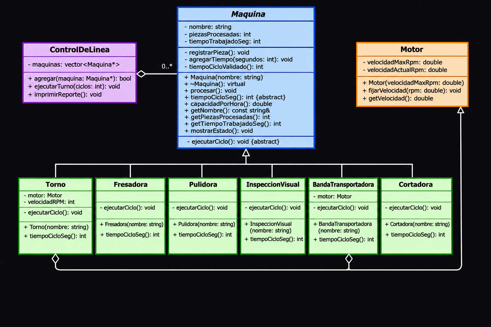

# Práctica Unidad IV: La evolución de una máquina

Programación Orientada a Objetos · Ingeniería Mecatrónica · Tercer semestre

Llena cada espacio conforme avances en las fases de [PRACTICA.md](PRACTICA.md).

 
 

## Fase 1. Entender el problema

**1.1 El problema con mis propias palabras**

Mi clase maquina del proyecto final del parcial 2 tenia un problema de diseño por que no protegia correctamente sus atributos ya que era posible que otras partes del programa modifiquen sus datos de forma libre ya que no habian restricciones adecuadas que evitaran posibles situaciones que segun lo planeado no deberian pasar por logica pero que si son posibles de ocurrir.

Para poder evitar estos posibles errores es necesario establecer y tomar en cuenta reglas que permitan mantener los datos de cada maquina en un estado valido para evitar errores y de esta forma garantizar que todas las maquinas respeten las condicones bases del funcionamiento del sistema.

 

**1.2 Reglas que siempre deben cumplirse en una máquina** (escribe al menos tres)

1. Las piezas procesadas nunca deben de ser negativas.
2. El tiempo trabajado no puede ser negativo.
3. El nombre de la maquina no debe estar vacio.

 

**1.3 ¿Quién más usa la clase `Maquina`? ¿Qué podría salir mal si otro equipo crea una máquina nueva sin conocer tus reglas?**

La clase maquina es utilizada por todas las diferentes maquinas que heredan de esta clase como por ejemplo torno, fresadora, cortadora y etc. 

Si otro equipo desarrolla una nueva maquina sin conocer las reglas planteadas, podria implemnetar un comportamiento incorrecto como por ejemplo permitir que procese piezas estando apagadas las maquinas, que no registre correctamnete las piezas o que continue trabajando cuando se encuentr en falla, si llega a pasar algunos de estos caos se podrian provocar errores en la linea de produccion y obtener resultadis incorrectos en el reporte final.

 
 

## Fase 2. Diseñar la solución

**2.1 Diagrama inicial (Etapa 0)**

 

**2.2 Diagrama final (Etapa 9)**

 

**2.3 ¿Qué cambió entre los dos diagramas?**

| Elemento | Etapa 0 | Etapa 9 | Etapa que lo cambió |
| --- | --- | --- | --- |
| Visibilidad de los atributos de `Maquina` | Publicos(public) | Provados(private) | Etapa 1 |
| `procesar()` | Publico y no virtual | Público y no virtual; la clase base controla el ciclo mediante NVI | Etapa 7 |
| `tiempoCicloSeg()` | No existia | Publico y virtual puro(=0) | Etapa 5 |
| Destructor de `Maquina` | ¿No tenia un destructor virtual declarado | Destructor virtual (virtual ~Maquina() = default) | Etapa 4 |
| ¿Se pueden crear objetos `Maquina`? | Sí, era una clase concreta | No, es una clase abstracta | Etapa 5 |
| Relación `ControlDeLinea` - `Maquina` | No existía ControlDeLinea; se utilizaba una función con Maquina& | Agregación mediante vector<Maquina*> | Etapa 3 |
| Relación `Torno` - `Motor` | No existia | Composición: Torno contiene un objeto Motor | Etapa 4 |
| Relación `BandaTransportadora` - `Motor` | No exixtia | Composición: BandaTransportadora contiene un objeto Motor | Etapa 8 |

 
 

## Fase 3. Implementar

**3.0 Etapa 0. Una máquina sin reglas**

a) ¿Qué imprime `ejecutarTurno()` para el torno y la fresadora? ¿Por qué no imprime "torneando" ni "fresando"?

Dentro de la funcion ejecutarTurno() no parecen los mensajes especificos por que el metodo procesar() de la clase maquina todavia no esta declarado como virtual por lo que la funcion recibe una referencia del tipo maquina por lo que se ejecuta el metodo de la clase base. Los metodos procesar() de torno y fresadora solamente ocultan el metodo de la clase base, pero todavia no lo sobresriben por polimorfismo.

b) ¿Por qué el torno acumula 65 s y no 135 s?

El torno termina con 65 segundos por que la primera llamada a processar() ejecuta el metodo de Torno lo que suma al contador 45 segundos, despues cuando se ejecuta ejecutarTurno(), se hacen 2 ciclos, como el metodo procesar() de maquina no es virtual, cada ciclo suma solo 10 segundos.

 

**3.1 Etapa 1. Invariantes y constructores explicit**

a) ¿Qué regla de la sección 1.2 rompió `torno.piezasProcesadas = -5;`?

Rompio la regla de que el numero de piezas procesadas nunca debe de ser negativo. Al cambiar directamente el atributo, se permitio que la maquina tuviera un estado invalido y no coherente.

b) ¿De dónde salió la máquina "Fantasma"? ¿Qué hizo el compilador sin que se lo pidieras?

La máquina se creó automáticamente mediante una conversión implícita. Como el constructor Maquina(const std::string& nombre) no tiene la palabra explicit, C++ convirtió el std::string "Fantasma" en un objeto temporal de tipo Maquina para poder llamar a imprimirFicha().

c) ¿Qué tuviste que cambiar en `Torno` y `Fresadora` y por qué?

Tuve que modificar las clases Torno y Fresadora para que dejaran de acceder directamente a los atributos de la clase Maquina. En su lugar, utilicé los métodos protegidos registrarPieza() y agregarTiempo() para actualizar las piezas procesadas y el tiempo trabajado, así como el método público getNombre() para consultar el nombre de la máquina.

Estos cambios fueron necesarios porque los atributos de Maquina ahora son privados, por lo que no pueden modificarse directamente desde las clases derivadas, así se protege el estado interno de la clase base y se respetan sus invariantes.

 

**3.2 Etapa 2. Virtual y override**

a) La fresadora acumula 180 s, pero reporta 360 pzas/h. ¿Por qué un cálculo usó 60 s y el otro 10 s?

Esto sucede porque el método tiempoCicloSeg() de Fresadora no tiene const, mientras que el método de Maquina sí lo tiene. Por lo tanto, no se sobrescribe correctamente el método de la clase base. Cuando se calcula el tiempo de procesamiento se utiliza el método de Fresadora, que devuelve 60 segundos. sin embargo, cuando se calcula la capacidad desde mostrarEstado(), se utiliza el método de Maquina que devuelve 10 segundos.

b) ¿Tu compilador mostró alguna advertencia antes de usar `override`? ¿Qué mensaje dio después de agregar `override`?

Sí el compilador mostró una advertencia indicando que el método tiempoCicloSeg() de Fresadora oculta el método virtual de Maquina. Esto creo que pasa porque las firmas de ambos métodos son diferentes debido a la ausencia de const en Fresadora.

 

**3.3 Etapa 3. La línea de producción**

a) ¿Por qué la línea procesó todo como "generico" si `procesar()` ya es virtual?

Porque en ControlDeLinea utilizamos std::vector Maquina, que almacena objetos por valor. Al agregar un Torno o una Fresadora, solamente se copia la parte correspondiente a la clase base Maquina, perdiéndose las características específicas de las clases derivadas. A este problema se conoce normalmente como slicing o rebanado de objetos, por esta razon se ejecuta el método genérico de Maquina.

b) ¿Por qué el torno y la fresadora originales quedaron con 0 piezas?

Porque el método agregar() guarda copias de las máquinas dentro del vector en lugar de guardar referencias a los objetos originales. Por lo tanto al ejecutar los ciclos se modifican las copias almacenadas en ControlDeLinea, mientras que los objetos originales torno y fresadora permanecen sin cambios.

c) La relación entre `ControlDeLinea` y `Maquina`, ¿es composición o agregación? ¿Por qué?

Es una relación de agregación porque ControlDeLinea no crea ni es propietario de las máquinas solamente almacena punteros para utilizarlos. Las máquinas existen independientemente de la línea de producción y no se destruyen cuando esta deja de existir.

 

**3.4 Etapa 4. Destructores**

| Momento | Mensajes de destrucción que aparecieron |
| --- | --- |
| `delete temporal;` sin destructor virtual | Destruyendo Maquina |
| `delete temporal;` con destructor virtual | Destruyendo Torno-> Destruyendo Motor-> Destruyendo Maquina |
| Al terminar `main` (torno y fresadora) | Destruyendo Maquina (Fresadora) → Destruyendo Torno → Destruyendo Motor → Destruyendo Maquina (Torno) |

a) ¿Qué advertencia mostró el compilador? ¿Por qué decimos que ya te estaba avisando del problema?

deleting object of polymorphic class type 'Maquina' which has non-virtual destructor might cause undefined behavior

El compilador nos avisa que estamos eliminando un objeto Torno mediante un puntero de tipo Maquina*, pero el destructor de Maquina no es virtual. Esto puede provocar un comportamiento indefinido y evitar que se ejecuten correctamente los destructores de la clase derivada y sus componentes.

b) ¿Por qué el torno de `main` sí se destruyó completo aunque el destructor no fuera virtual? ¿A qué máquina corresponde el primer "Destruyendo Maquina" después de "Fin de main"?

Porque los objetos locales (torno y fresadora) se destruyen automáticamente utilizando su tipo concreto al terminar main. En cambio, delete temporal utiliza un puntero de tipo Maquina*, por lo que, sin un destructor virtual, no garantiza la destrucción correcta del objeto derivado.

El primer mensaje Destruyendo Maquina después de Fin de main corresponde a la Fresadora, porque fue el último objeto local que se creó y los objetos locales se destruyen en orden inverso al de su creación.

 

**3.5 Etapa 5. La clase abstracta**

a) Copia los mensajes de error y explica con tus palabras qué dice cada uno.

Error 1: Pulidora
error: cannot declare variable 'pulidora' to be of abstract type 'Pulidora'

La clase Pulidora no implementa el método virtual puro procesar() que hereda de Maquina. Por eso, el compilador no permite crear un objeto de esta clase.

Error 2: Maquina genérica
error: cannot declare variable 'generica' to be of abstract type 'Maquina'

La clase Maquina ahora es abstracta porque tiene dos métodos virtuales puros: procesar() y tiempoCicloSeg(). Por lo tanto, no podemos crear objetos directamente de ella.

b) ¿Por qué es mejor este error de compilación que el comportamiento "generico" de antes?

Es mejor que ocurra un error de compilación porque nos permite detectar desde el principio que una clase derivada no implementó los métodos necesarios. Antes, la máquina podía utilizar el procesamiento genérico aunque no realizara una función específica, lo que podía generar resultados incorrectos. Al convertir Maquina en una clase abstracta, el compilador obliga a que cada máquina implemente su propio comportamiento antes de permitir que se creen sus objetos.

 

**3.6 Etapa 6. El contrato que el compilador no ve**

a) ¿Qué partes del contrato violó `InspeccionVisual`?

La clase InspeccionVisual no cumple con el contrato porque su método procesar() no registra las piezas ni suma el tiempo que tarda en procesarlas. Además, el método tiempoCicloSeg() devuelve 0, cuando debería devolver un valor mayor que cero.

b) ¿Por qué el compilador no lo detectó?

Porque el compilador solamente revisa que los métodos estén declarados correctamente y que coincidan con los de la clase base. No puede saber si realmente hacen lo que deberían hacer cuando se ejecutan.

c) ¿Qué pasaría si el próximo equipo tampoco lee el comentario del contrato?

Podría cometer el mismo error al crear otra máquina, porque el comentario no obliga a cumplir con esas reglas. El programa podría compilar y funcionar, pero dar resultados incorrectos en los reportes, como pasó con InspeccionVisual.

 

**3.7 Etapa 7. La base hace cumplir el contrato**

a) ¿Cómo puede una clase derivada sobrescribir un método que es privado en la base?

Una clase derivada puede sobrescribir un método privado de la clase base porque en C++ el control de acceso (private) y la sobrescritura (virtual) son independientes. La palabra private impide que otras clases llamen directamente al método, mientras que virtual permite que una clase derivada proporcione su propia implementación. Por eso, las clases derivadas pueden sobrescribir ejecutarCiclo(), aunque no puedan llamarlo directamente.

b) ¿Qué ocurre ahora con una máquina cuyo tiempo de ciclo es 0? Compáralo con la Etapa 6.

En la Etapa 6, cuando una máquina devolvía un tiempo de ciclo igual a cero, se podía producir un resultado incorrecto en el reporte, mostrando una capacidad infinita (inf). En la Etapa 7, la clase base valida que el tiempo sea mayor que cero antes de ejecutar el ciclo. Si el tiempo es inválido, lanza una excepción std::logic_error, que muestra un mensaje indicando qué máquina incumplió el contrato. De esta manera se evita registrar información incorrecta.

c) ¿Por qué la línea ignoró el "atajo" del torno, pero la llamada directa no? ¿Cómo corregiste el diseño?

La línea utiliza punteros de tipo Maquina* para trabajar con las máquinas y llama al método procesar() de la clase base. Como este método no es virtual, la línea ejecuta siempre la implementación de Maquina. En cambio, cuando se llama directamente a torno.procesar(), se ejecuta el método propio de Torno, porque oculta al método de la clase base. Para corregir el diseño, eliminé el método procesar() de Torno, dejando que únicamente la clase base controle el procesamiento y que las clases derivadas personalicen el trabajo mediante ejecutarCiclo().

 

**3.8 Etapa 8. Herencia mal usada**

a) Da al menos dos razones por las que `BandaTransportadora : public Motor` es un error de diseño.

1. La banda no es un motor. La herencia representa una relación de tipo «es un». Una banda transportadora no puede considerarse un motor; simplemente utiliza uno para funcionar. Por eso, heredar de Motor representa incorrectamente la relación entre ambas clases.

2. La banda deja de ser una Maquina. Como hereda de Motor y no de Maquina, no puede agregarse a ControlDeLinea, cuyo método agregar() recibe objetos de tipo Maquina*. Esto provoca el error de compilación que observamos.

3. Se permite modificar directamente la velocidad del motor. Al heredar de Motor, la banda obtiene acceso a métodos como fijarVelocidad(). Esto permite que otras partes del programa cambien su velocidad directamente, sin que la propia banda controle ese comportamiento.

b) La relación entre `BandaTransportadora` y `Motor`, ¿es composición o agregación? ¿Por qué?

La relación es de composición, porque la banda transportadora tiene un motor como parte de su estructura y lo utiliza para funcionar. El motor es un componente interno de la banda, por lo que su funcionamiento depende de este componente. No se trata de una relación de herencia, porque una banda no es un motor, sino que tiene uno.

 

**3.9 Etapa 9. La librería y la prueba final**

a) Después de agregar la `Cortadora`, ¿qué archivos mostró `git status`? ¿Cuántos archivos de la librería tuviste que modificar?

La biblioteca estática contiene los archivos objeto de las máquinas y sus componentes. Para agregar una máquina nueva sin modificar la biblioteca, solamente es necesario crear su archivo .h y .cpp, además de actualizar main.cpp. No es necesario modificar los archivos originales de la biblioteca.

b) ¿Qué pasó al escribir `-lplanta` antes de `src/main.cpp`? ¿Por qué?

El enlazador mostró errores undefined reference porque la biblioteca se colocó antes del archivo principal. El enlazador procesa los archivos en orden y, cuando revisó la biblioteca, todavía no conocía las referencias que necesitaba resolver. Al colocar src/main.cpp antes de -lplanta, el enlazado se realizó correctamente.

 

**3.10 Bitácora de dudas**

| # | Etapa | Duda | Cómo la resolví | Fuente |
| --- | --- | --- | --- | --- |
| 1 | Etapa 2 | No entendía bien para qué servían virtual y override, ni cuál era la diferencia entre los dos. | Investigando y haciendo pruebas entendí que virtual permite que se ejecute el método correspondiente a la clase hija, mientras que override sirve para indicar que estoy sobrescribiendo un método de la clase base y ayuda a detectar errores. | PRACTICA.md y pruebas del código. |
| 2 | Etapa 3 | Tenía la duda de por qué se utilizaban punteros Maquina* en el vector de ControlDeLinea en lugar de guardar directamente los objetos. | Comprendí que de esta manera puedo agregar diferentes tipos de máquinas a una misma línea sin perder su comportamiento original. También entendí que la línea solamente utiliza las máquinas, pero no es la encargada de crearlas o destruirlas. | PRACTICA.md y ControlDeLinea.h. |
| 3 | Etapa 7 | No me quedaba claro cómo hacer que todas las máquinas registraran correctamente las piezas procesadas y el tiempo trabajado sin repetir ese código en cada clase. | Lo resolví utilizando el método procesar() en la clase base. Así, la clase Maquina se encarga de controlar el proceso y las clases hijas solamente implementan su propio ciclo de trabajo. | PRACTICA.md y Maquina.h / Maquina.cpp. |

 
 

## Fase 4. Probar y mejorar

**4.1 Tabla de pruebas**

| # | Caso | Resultado esperado | Resultado obtenido | ¿Pasa? |
| --- | --- | --- | --- | --- |
| 1 | Máquina con nombre vacío | Excepción con mensaje claro | Se permitió crear la máquina sin nombre y apareció el mensaje de error de la prueba. | No |
| 2 | Reporte de una línea vacía | "La linea no tiene maquinas" | Apareció el mensaje «La linea no tiene maquinas». | Si |
| 3 | `agregar(nullptr)` | Devuelve `false` | No permitió agregar nullptr y devolvió false. | Si |
| 4 | Reporte antes de ejecutar el turno | 0 piezas, 0 s y capacidad calculada | Mostró 0 piezas, 0 segundos y 80 pzas/h para el torno. | Si |
| 5 | Turno de 0 ciclos | Nada cambia | La máquina permaneció con 0 piezas y 0 segundos trabajados. | Si |
| 6 | Torno con 3 ciclos | 3 piezas, 135 s, 80 pzas/h | Procesó 3 piezas, acumuló 135 segundos y mostró 80 pzas/h. | Si |
| 7 | Máquina con `tiempoCicloSeg()` igual a 0 | Excepción con mensaje claro | Se lanzó una excepción indicando que el tiempo debe ser mayor que cero. | Si |
| 8 | Máquina con `tiempoCicloSeg()` negativo | Excepción con mensaje claro | Se lanzó una excepción indicando que el tiempo debe ser mayor que cero. | Si |
| 9 | La misma máquina agregada dos veces | Evitar que una máquina se registre más de una vez. | Permitió agregarla dos veces y procesó dos veces el mismo torno. | No |

**4.2 Bitácora de mejoras**

| # | Falla o mejora detectada | Qué cambié | Por qué |
| --- | --- | --- | --- |
| 1 | Se permitió agregar la misma máquina dos veces a la línea de producción. | Se identificó que sería necesario validar si la máquina ya está registrada antes de agregarla. |  Para evitar que una misma máquina procese piezas más veces de las solicitadas y que el reporte cuente información duplicada.|
| 2 | El constructor permite crear máquinas con nombres vacíos. | Se propone agregar una validación para rechazar nombres vacíos al crear una máquina. | Para evitar que existan máquinas sin identificación y facilitar su control dentro de la línea de producción. |

Retos opcionales que intenté: 
 

Validar el nombre de las máquinas: Probé crear una máquina con el nombre vacío y descubrí que el programa permite hacerlo. Identifiqué que sería necesario agregar una validación en el constructor de Maquina.

Evitar máquinas duplicadas: Probé agregar dos veces el mismo torno a ControlDeLinea. El programa permitió hacerlo y terminó procesando dos veces la misma máquina. Con esto identifiqué que sería conveniente validar que una máquina no esté registrada anteriormente.
 
 

## Fase 5. Publicar en GitHub

**5.1 Enlace a mi fork**

https://github.com/LuisSaSa4/ulsa_ime_3_poo_evolucion_maquina.git

 
 

## Cierre y reflexión

**6.1 Errores que ya no pueden ocurrir**

| Error | Etapa en que apareció | Restricción que lo impide ahora | ¿Quién lo detecta: el compilador o el programa? |
| --- | --- | --- | --- |
| Contadores con valores inválidos | Estapa 1 | Los atributos son privados y se inicializan desde el constructor | El programa |
| Máquina "fantasma" creada a escondidas | Etapa 1 | Se controla la creación de objetos mediante el constructor y la visibilidad de los atributos | El programa |
| Método que no sobrescribe por un `const` | Etapa 2 | Se utiliza override para comprobar que el método sobrescriba correctamente al de la clase base. | Elcompilador |
| Máquinas copiadas y "rebanadas" | Etapa 3 | Se utilizan punteros Maquina* en el vector de ControlDeLinea, en lugar de guardar objetos por valor | El diseño del programa |
| Destrucción incompleta | Etapa 4 |  Se utiliza un destructor virtual en la clase base Maquina.| El comportamiento del programa |
| Máquina sin `procesar()` propio | Etapa 5 |  Maquina es abstracta y obliga a implementar los métodos virtuales puros.| El compilador |
| Tiempo de ciclo inválido | Etapa 7 |  El método procesar() valida que el tiempo sea mayor que cero| El programa |
| Derivada que no registra sus piezas | Etapa 7 |  Se utiliza NVI: la clase base controla procesar() y las derivadas implementan ejecutarCiclo().| El diseño de la clase base |

**6.2 ¿Cuál de los errores fue el más peligroso: el de compilación, la advertencia o el que compilaba sin problemas? ¿Por qué?**

Considero que los errores más peligrosos son los que permiten que el programa compile sin mostrar ningún problema, porque pueden pasar desapercibidos y provocar resultados incorrectos durante la ejecución. Por ejemplo, al probar agregar dos veces el mismo torno, el programa compiló correctamente, pero terminó procesando dos veces la misma máquina. Esto me hizo entender que no basta con que el código compile, también es necesario probar que funcione como esperamos.

**6.3 ¿Qué aprendiste en esta práctica?**

Durante esta práctica aprendí a utilizar mejor la programación orientada a objetos en C++. Entendí la importancia de la herencia, el polimorfismo, la encapsulación y la composición. También aprendí para qué sirven los métodos virtuales, el uso de override y los destructores virtuales. Algo que me pareció importante fue aprender cómo una clase base puede controlar el comportamiento de sus clases derivadas mediante el patrón NVI. Además, comprendí que las pruebas ayudan a encontrar errores que no siempre aparecen al compilar.

**6.4 ¿Qué cambiarías de tu proceso la próxima vez?**

La próxima vez trataría de organizar mejor el trabajo desde el principio, empezando por revisar los requisitos y diseñar el diagrama UML antes de comenzar a programar. También intentaría hacer pruebas más seguido, en lugar de esperar hasta tener todo terminado. Otra cosa que cambiaría sería documentar las dudas y los errores conforme vayan apareciendo, para tener un mejor control de los cambios realizados y evitar problemas al integrar las diferentes clases.
