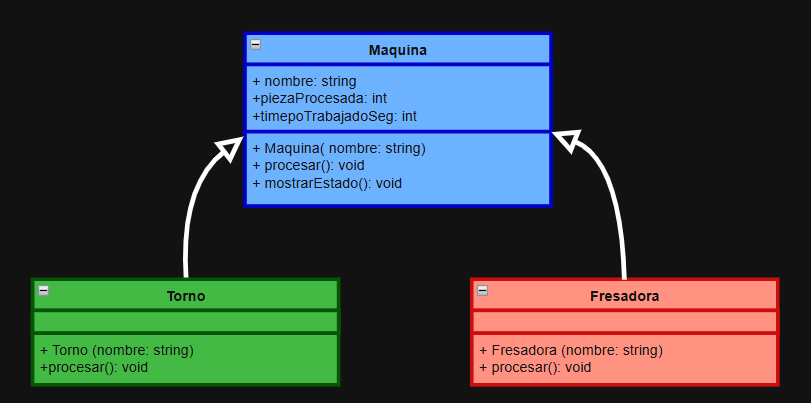

# Práctica Unidad IV: La evolución de una máquina

Programación Orientada a Objetos · Ingeniería Mecatrónica · Tercer semestre

Llena cada espacio conforme avances en las fases de [PRACTICA.md](PRACTICA.md).

 
 

## Fase 1. Entender el problema

**1.1 El problema con mis propias palabras**

Mi clase maquina del proyecto final del parcial 2 tenia un problema de diseño por que no protegia correctamente sus atributos ya que era posible que otras partes del programa modifiquen sus datos de forma libre ya que no habian restricciones adecuadas que evitaran posibles situaciones que segun lo planeado no deberian pasar por logica pero que si son posibles de ocurrir.

Para poder evitar estos posibles errores es necesario establecer y tomar en cuenta reglas que permitan mantener los datos de cada maquina en un estado valido para evitar errores y de esta forma garantizar que todas las maquinas respeten las condicones bases del funcionamiento del sistema.

 

**1.2 Reglas que siempre deben cumplirse en una máquina** (escribe al menos tres)

1. Las piezas procesadas nunca deben de ser negativas.
2. El tiempo trabajado no puede ser negativo.
3. El nombre de la maquina no debe estar vacio.

 

**1.3 ¿Quién más usa la clase `Maquina`? ¿Qué podría salir mal si otro equipo crea una máquina nueva sin conocer tus reglas?**

La clase maquina es utilizada por todas las diferentes maquinas que heredan de esta clase como por ejemplo torno, fresadora, cortadora y etc. 

Si otro equipo desarrolla una nueva maquina sin conocer las reglas planteadas, podria implemnetar un comportamiento incorrecto como por ejemplo permitir que procese piezas estando apagadas las maquinas, que no registre correctamnete las piezas o que continue trabajando cuando se encuentr en falla, si llega a pasar algunos de estos caos se podrian provocar errores en la linea de produccion y obtener resultadis incorrectos en el reporte final.

 
 

## Fase 2. Diseñar la solución

**2.1 Diagrama inicial (Etapa 0)**

 

**2.2 Diagrama final (Etapa 9)**

 

**2.3 ¿Qué cambió entre los dos diagramas?**

| Elemento | Etapa 0 | Etapa 9 | Etapa que lo cambió |
| --- | --- | --- | --- |
| Visibilidad de los atributos de `Maquina` | _____ | _____ | _____ |
| `procesar()` | _____ | _____ | _____ |
| `tiempoCicloSeg()` | _____ | _____ | _____ |
| Destructor de `Maquina` | _____ | _____ | _____ |
| ¿Se pueden crear objetos `Maquina`? | _____ | _____ | _____ |
| Relación `ControlDeLinea` - `Maquina` | _____ | _____ | _____ |
| Relación `Torno` - `Motor` | _____ | _____ | _____ |
| Relación `BandaTransportadora` - `Motor` | _____ | _____ | _____ |

 
 

## Fase 3. Implementar

**3.0 Etapa 0. Una máquina sin reglas**

a) ¿Qué imprime `ejecutarTurno()` para el torno y la fresadora? ¿Por qué no imprime "torneando" ni "fresando"?

Dentro de la funcion ejecutarTurno() no parecen los mensajes especificos por que el metodo procesar() de la clase maquina todavia no esta declarado como virtual por lo que la funcion recibe una referencia del tipo maquina por lo que se ejecuta el metodo de la clase base. Los metodos procesar() de torno y fresadora solamente ocultan el metodo de la clase base, pero todavia no lo sobresriben por polimorfismo.

b) ¿Por qué el torno acumula 65 s y no 135 s?

El torno termina con 65 segundos por que la primera llamada a processar() ejecuta el metodo de Torno lo que suma al contador 45 segundos, despues cuando se ejecuta ejecutarTurno(), se hacen 2 ciclos, como el metodo procesar() de maquina no es virtual, cada ciclo suma solo 10 segundos.

 

**3.1 Etapa 1. Invariantes y constructores explicit**

a) ¿Qué regla de la sección 1.2 rompió `torno.piezasProcesadas = -5;`?

Rompio la regla de que el numero de piezas procesadas nunca debe de ser negativo. Al cambiar directamente el atributo, se permitio que la maquina tuviera un estado invalido y no coherente.

b) ¿De dónde salió la máquina "Fantasma"? ¿Qué hizo el compilador sin que se lo pidieras?

La máquina se creó automáticamente mediante una conversión implícita. Como el constructor Maquina(const std::string& nombre) no tiene la palabra explicit, C++ convirtió el std::string "Fantasma" en un objeto temporal de tipo Maquina para poder llamar a imprimirFicha().

c) ¿Qué tuviste que cambiar en `Torno` y `Fresadora` y por qué?

Tuve que modificar las clases Torno y Fresadora para que dejaran de acceder directamente a los atributos de la clase Maquina. En su lugar, utilicé los métodos protegidos registrarPieza() y agregarTiempo() para actualizar las piezas procesadas y el tiempo trabajado, así como el método público getNombre() para consultar el nombre de la máquina.

Estos cambios fueron necesarios porque los atributos de Maquina ahora son privados, por lo que no pueden modificarse directamente desde las clases derivadas, así se protege el estado interno de la clase base y se respetan sus invariantes.

 

**3.2 Etapa 2. Virtual y override**

a) La fresadora acumula 180 s, pero reporta 360 pzas/h. ¿Por qué un cálculo usó 60 s y el otro 10 s?

Esto sucede porque el método tiempoCicloSeg() de Fresadora no tiene const, mientras que el método de Maquina sí lo tiene. Por lo tanto, no se sobrescribe correctamente el método de la clase base. Cuando se calcula el tiempo de procesamiento se utiliza el método de Fresadora, que devuelve 60 segundos. sin embargo, cuando se calcula la capacidad desde mostrarEstado(), se utiliza el método de Maquina que devuelve 10 segundos.

b) ¿Tu compilador mostró alguna advertencia antes de usar `override`? ¿Qué mensaje dio después de agregar `override`?

Sí el compilador mostró una advertencia indicando que el método tiempoCicloSeg() de Fresadora oculta el método virtual de Maquina. Esto creo que pasa porque las firmas de ambos métodos son diferentes debido a la ausencia de const en Fresadora.

 

**3.3 Etapa 3. La línea de producción**

a) ¿Por qué la línea procesó todo como "generico" si `procesar()` ya es virtual?

Porque en ControlDeLinea utilizamos std::vector Maquina, que almacena objetos por valor. Al agregar un Torno o una Fresadora, solamente se copia la parte correspondiente a la clase base Maquina, perdiéndose las características específicas de las clases derivadas. A este problema se conoce normalmente como slicing o rebanado de objetos, por esta razon se ejecuta el método genérico de Maquina.

b) ¿Por qué el torno y la fresadora originales quedaron con 0 piezas?

Porque el método agregar() guarda copias de las máquinas dentro del vector en lugar de guardar referencias a los objetos originales. Por lo tanto al ejecutar los ciclos se modifican las copias almacenadas en ControlDeLinea, mientras que los objetos originales torno y fresadora permanecen sin cambios.

c) La relación entre `ControlDeLinea` y `Maquina`, ¿es composición o agregación? ¿Por qué?

Es una relación de agregación porque ControlDeLinea no crea ni es propietario de las máquinas solamente almacena punteros para utilizarlos. Las máquinas existen independientemente de la línea de producción y no se destruyen cuando esta deja de existir.

 

**3.4 Etapa 4. Destructores**

| Momento | Mensajes de destrucción que aparecieron |
| --- | --- |
| `delete temporal;` sin destructor virtual | Destruyendo Maquina |
| `delete temporal;` con destructor virtual | Destruyendo Torno-> Destruyendo Motor-> Destruyendo Maquina |
| Al terminar `main` (torno y fresadora) | Destruyendo Maquina (Fresadora) → Destruyendo Torno → Destruyendo Motor → Destruyendo Maquina (Torno) |

a) ¿Qué advertencia mostró el compilador? ¿Por qué decimos que ya te estaba avisando del problema?

deleting object of polymorphic class type 'Maquina' which has non-virtual destructor might cause undefined behavior

El compilador nos avisa que estamos eliminando un objeto Torno mediante un puntero de tipo Maquina*, pero el destructor de Maquina no es virtual. Esto puede provocar un comportamiento indefinido y evitar que se ejecuten correctamente los destructores de la clase derivada y sus componentes.

b) ¿Por qué el torno de `main` sí se destruyó completo aunque el destructor no fuera virtual? ¿A qué máquina corresponde el primer "Destruyendo Maquina" después de "Fin de main"?

Porque los objetos locales (torno y fresadora) se destruyen automáticamente utilizando su tipo concreto al terminar main. En cambio, delete temporal utiliza un puntero de tipo Maquina*, por lo que, sin un destructor virtual, no garantiza la destrucción correcta del objeto derivado.

El primer mensaje Destruyendo Maquina después de Fin de main corresponde a la Fresadora, porque fue el último objeto local que se creó y los objetos locales se destruyen en orden inverso al de su creación.

 

**3.5 Etapa 5. La clase abstracta**

a) Copia los mensajes de error y explica con tus palabras qué dice cada uno.

Error 1: Pulidora
error: cannot declare variable 'pulidora' to be of abstract type 'Pulidora'

La clase Pulidora no implementa el método virtual puro procesar() que hereda de Maquina. Por eso, el compilador no permite crear un objeto de esta clase.

Error 2: Maquina genérica
error: cannot declare variable 'generica' to be of abstract type 'Maquina'

La clase Maquina ahora es abstracta porque tiene dos métodos virtuales puros: procesar() y tiempoCicloSeg(). Por lo tanto, no podemos crear objetos directamente de ella.

b) ¿Por qué es mejor este error de compilación que el comportamiento "generico" de antes?

Es mejor que ocurra un error de compilación porque nos permite detectar desde el principio que una clase derivada no implementó los métodos necesarios. Antes, la máquina podía utilizar el procesamiento genérico aunque no realizara una función específica, lo que podía generar resultados incorrectos. Al convertir Maquina en una clase abstracta, el compilador obliga a que cada máquina implemente su propio comportamiento antes de permitir que se creen sus objetos.

 

**3.6 Etapa 6. El contrato que el compilador no ve**

a) ¿Qué partes del contrato violó `InspeccionVisual`?

La clase InspeccionVisual no cumple con el contrato porque su método procesar() no registra las piezas ni suma el tiempo que tarda en procesarlas. Además, el método tiempoCicloSeg() devuelve 0, cuando debería devolver un valor mayor que cero.

b) ¿Por qué el compilador no lo detectó?

Porque el compilador solamente revisa que los métodos estén declarados correctamente y que coincidan con los de la clase base. No puede saber si realmente hacen lo que deberían hacer cuando se ejecutan.

c) ¿Qué pasaría si el próximo equipo tampoco lee el comentario del contrato?

Podría cometer el mismo error al crear otra máquina, porque el comentario no obliga a cumplir con esas reglas. El programa podría compilar y funcionar, pero dar resultados incorrectos en los reportes, como pasó con InspeccionVisual.

 

**3.7 Etapa 7. La base hace cumplir el contrato**

a) ¿Cómo puede una clase derivada sobrescribir un método que es privado en la base?

[Inserta aquí tu respuesta]

b) ¿Qué ocurre ahora con una máquina cuyo tiempo de ciclo es 0? Compáralo con la Etapa 6.

[Inserta aquí tu respuesta]

c) ¿Por qué la línea ignoró el "atajo" del torno, pero la llamada directa no? ¿Cómo corregiste el diseño?

[Inserta aquí tu respuesta]

 

**3.8 Etapa 8. Herencia mal usada**

a) Da al menos dos razones por las que `BandaTransportadora : public Motor` es un error de diseño.

[Inserta aquí tu respuesta]

b) La relación entre `BandaTransportadora` y `Motor`, ¿es composición o agregación? ¿Por qué?

[Inserta aquí tu respuesta]

 

**3.9 Etapa 9. La librería y la prueba final**

a) Después de agregar la `Cortadora`, ¿qué archivos mostró `git status`? ¿Cuántos archivos de la librería tuviste que modificar?

[Inserta aquí tu respuesta]

b) ¿Qué pasó al escribir `-lplanta` antes de `src/main.cpp`? ¿Por qué?

[Inserta aquí tu respuesta]

 

**3.10 Bitácora de dudas**

| # | Etapa | Duda | Cómo la resolví | Fuente |
| --- | --- | --- | --- | --- |
| 1 | _____ | _____ | _____ | _____ |
| 2 | _____ | _____ | _____ | _____ |
| 3 | _____ | _____ | _____ | _____ |

 
 

## Fase 4. Probar y mejorar

**4.1 Tabla de pruebas**

| # | Caso | Resultado esperado | Resultado obtenido | ¿Pasa? |
| --- | --- | --- | --- | --- |
| 1 | Máquina con nombre vacío | Excepción con mensaje claro | _____ | _____ |
| 2 | Reporte de una línea vacía | "La linea no tiene maquinas" | _____ | _____ |
| 3 | `agregar(nullptr)` | Devuelve `false` | _____ | _____ |
| 4 | Reporte antes de ejecutar el turno | 0 piezas, 0 s y capacidad calculada | _____ | _____ |
| 5 | Turno de 0 ciclos | Nada cambia | _____ | _____ |
| 6 | Torno con 3 ciclos | 3 piezas, 135 s, 80 pzas/h | _____ | _____ |
| 7 | Máquina con `tiempoCicloSeg()` igual a 0 | Excepción con mensaje claro | _____ | _____ |
| 8 | Máquina con `tiempoCicloSeg()` negativo | Excepción con mensaje claro | _____ | _____ |
| 9 | La misma máquina agregada dos veces | _____ | _____ | _____ |

**4.2 Bitácora de mejoras**

| # | Falla o mejora detectada | Qué cambié | Por qué |
| --- | --- | --- | --- |
| 1 | _____ | _____ | _____ |
| 2 | _____ | _____ | _____ |

Retos opcionales que intenté: _____

 
 

## Fase 5. Publicar en GitHub

**5.1 Enlace a mi fork**

[Inserta aquí el enlace a tu fork]

 
 

## Cierre y reflexión

**6.1 Errores que ya no pueden ocurrir**

| Error | Etapa en que apareció | Restricción que lo impide ahora | ¿Quién lo detecta: el compilador o el programa? |
| --- | --- | --- | --- |
| Contadores con valores inválidos | _____ | _____ | _____ |
| Máquina "fantasma" creada a escondidas | _____ | _____ | _____ |
| Método que no sobrescribe por un `const` | _____ | _____ | _____ |
| Máquinas copiadas y "rebanadas" | _____ | _____ | _____ |
| Destrucción incompleta | _____ | _____ | _____ |
| Máquina sin `procesar()` propio | _____ | _____ | _____ |
| Tiempo de ciclo inválido | _____ | _____ | _____ |
| Derivada que no registra sus piezas | _____ | _____ | _____ |

**6.2 ¿Cuál de los errores fue el más peligroso: el de compilación, la advertencia o el que compilaba sin problemas? ¿Por qué?**

[Inserta aquí tu respuesta]

**6.3 ¿Qué aprendiste en esta práctica?**

[Inserta aquí tu respuesta]

**6.4 ¿Qué cambiarías de tu proceso la próxima vez?**

[Inserta aquí tu respuesta]
